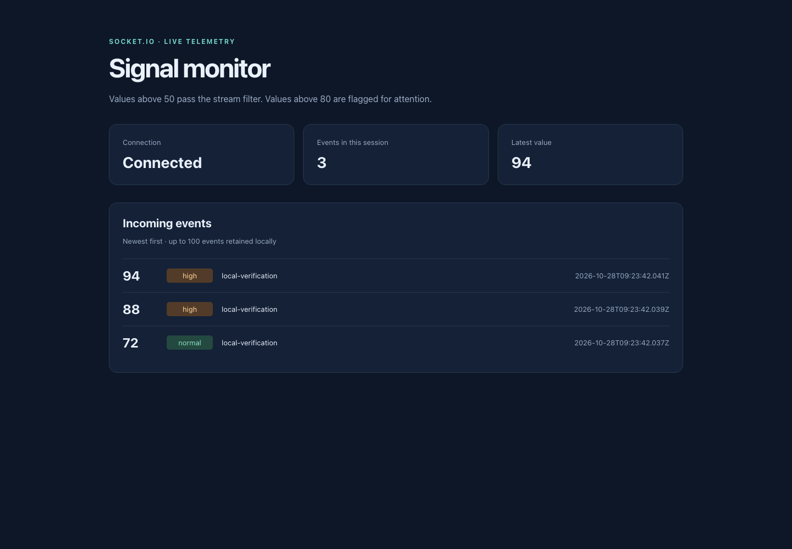
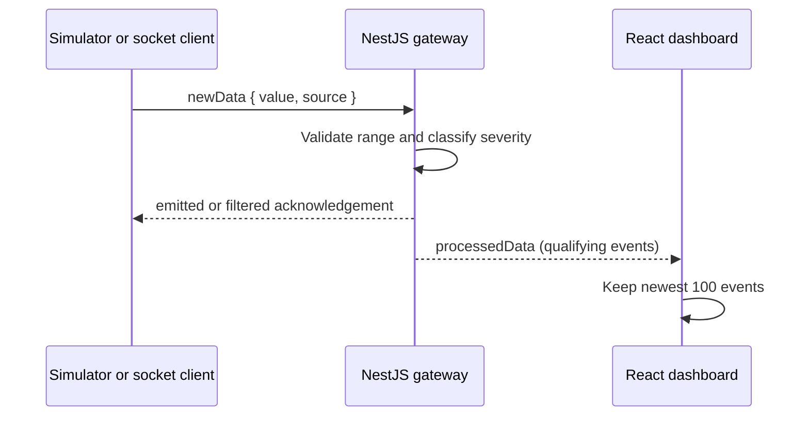

# Signal monitor

A NestJS + React demonstration of a live telemetry pipeline. A Socket.IO gateway
accepts numeric events, filters values at or below 50, assigns a severity, and
broadcasts qualifying events to connected dashboards. A built-in simulator makes
it possible to try the whole path without an external data source.



## Run two processes

Use Node 22. Install the two applications independently; the root package does
not run hidden dependency installs:

```bash
npm ci --prefix backend
npm ci --prefix frontend
npm run build --prefix backend
npm start --prefix backend
```

In another terminal:

```bash
npm start --prefix frontend
```

Open http://localhost:3000. The API/socket server listens on **3001**, so the two
services do not compete for a port. The default simulator sends a value every
two seconds, but the filter means some ticks produce no visible event. The UI
shows connection state and retains the newest 100 events in memory.

Optional configuration is documented in `backend/.env.example` and
`frontend/.env.example`. CRA loads `frontend/.env.local`; the backend reads its
process environment. For example, run `SIMULATE_DATA=false npm start --prefix backend`
to disable the simulator. Set `REACT_APP_SOCKET_URL` before building the frontend
if the socket endpoint differs; set backend `CORS_ORIGIN` to the frontend origin.

## Message contract

```js
socket.emit('newData', { value: 88, source: 'example-client' }, acknowledgement => {
  console.log(acknowledgement); // { status: 'emitted' }
});
socket.on('processedData', event => console.log(event));
```

Values must be finite numbers in `(50, 100]`; 80 is normal and values above 80 are
high severity. Invalid or filtered events receive `{ status: 'filtered' }`.
The server creates `processedAt`, limits source labels to 80 characters and drops
unrecognized input fields. Socket messages are capped at 16 KiB.



Each mounted dashboard owns its socket and disconnects it on unmount. The gateway
owns one simulator timer and clears it during application shutdown. `/health`
checks the HTTP process; it is not a guarantee that any producer is active.

## Verify and package

```bash
npm test --prefix backend -- --runInBand
npm test --prefix frontend -- --watchAll=false --runInBand
npm run build
```

Tests exercise filter/severity boundaries, timer cleanup, connection state,
invalid event handling and the UI retention limit. Desktop/mobile captures were
made against the native API and actual socket traffic, not a static mockup.

A multi-stage Dockerfile also packages the frontend into `backend/public`:
`docker compose up --build`, then open http://localhost:3001. Container startup
has not been exercised in this environment; the native process setup was verified.

This is a single-process broadcast demo. It has no durable event log, user
permissions, producer authentication or backpressure protocol. A public deployment
needs those boundaries and a shared Socket.IO adapter before adding replicas.
